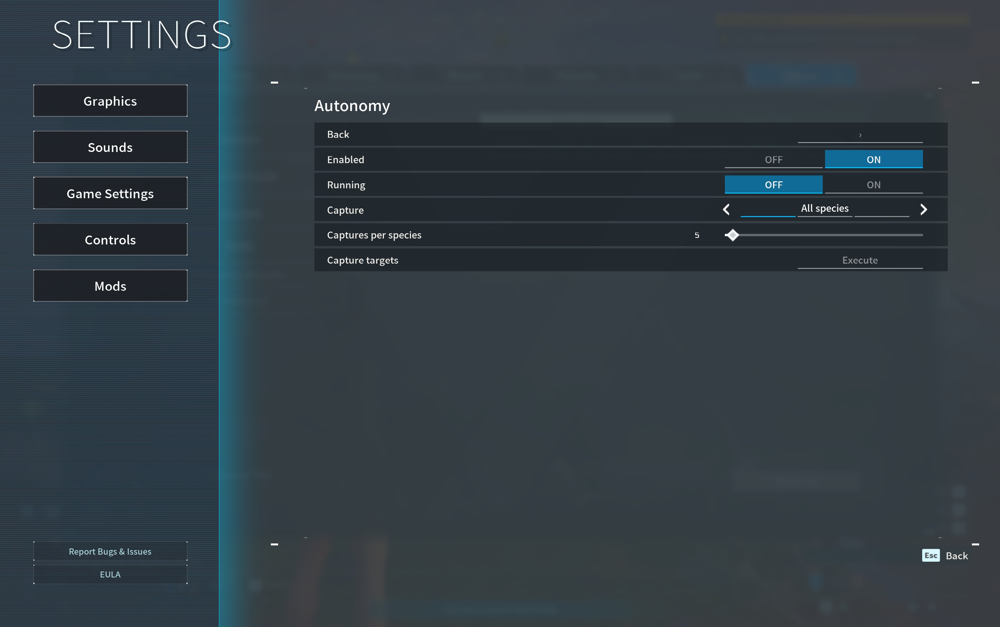

# Palworld Autonomy

An experimental capture and gathering controller for
[Palworld Mods](https://github.com/lansbe/palworld-mods). Set goals and let the
local controller act inside the game. No AI account or MCP client is required.

**[Get the Mac app](https://github.com/lansbe/palworld-mods/releases/latest)** ·
[Installation](#install-from-the-game) · [First session](#try-it-in-a-test-world) ·
[Contributing](CONTRIBUTING.md)

*Enabled makes the mod available. Running starts the controller; it is off here.*

## Install from the game

1. Quit Palworld. On the [Palworld Mods release page](https://github.com/lansbe/palworld-mods/releases/latest),
   expand **Assets** and download the **-macos-arm64.dmg** file.
2. Open the disk image, **drag Palworld Mods into Applications**, then eject it.
3. Open **Palworld Mods** from Applications.
4. In **Options → Mods → Manage mods**, select the gray **Autonomy** entry to
   install it. If already installed, return to the Mods page.
5. Open **Options → Mods → Autonomy**. Leave **Running** off until you are ready.

No separate mod download or game restart is needed. Requires Apple silicon,
macOS 14+, the supported Mac App Store game (app 1.0.8, build 102999), and
Palworld Mods 0.3.0 or newer. Use the latest app for fixes.
The [app guide](https://github.com/lansbe/palworld-mods#install-in-five-steps)
also covers macOS first-launch approval.

## Try it in a test world

1. Join a temporary world and stand somewhere safe. Bring suitable equipment,
   food and Pal Spheres; the controller uses your actual supplies.
2. In **Options → Mods → Autonomy**, keep **Enabled** on.
3. Choose **Capture → All species** and a small **Captures per species** goal
   for a first supervised test. The default is five lifetime captures per species,
   not five additional captures every session.
4. Turn **Running** on last, then close the menus so the controller can proceed.
5. To stop, reopen the menu and turn **Running** off. Opening a menu pauses actions.

The controller checks nearby eligible wild Pals/resources, plans walking routes
and aligns the camera before actions. Capture history confirms captures;
inventory changes confirm gathering. Travel or disabling releases held inputs,
and death stops the session. It does not spawn supplies or bypass the host's rules.

### Advanced goals and current menu limitation

The controller supports selected species, materials, a search radius, a level
ceiling, sphere reserves, retreat health and a session time limit.

| Goal | Value |
| --- | --- |
| Bring lifetime captures up to a target | All species, with a captures-per-species quota. |
| Capture selected species | Selected, with targets such as **Lamball=5; Cattiva=3**. |
| Gather resources | Materials such as **Wood=100; Stone=50**, or the Wood/Stone goals. |
| Gather without capturing | Capture mode Off, with material goals set. |

**Known issue in Palworld Mods 0.4.2:** in the documented session, the native
Autonomy panel stopped at Capture targets, showing an inactive Execute control.
The text fields and later settings were not available in that session. Do not
expect to configure all advanced goals from that panel until this is fixed.

Advanced users can configure those goals through the optional
[Palworld MCP bridge](https://github.com/lansbe/palworld-mcp). With the game open,
this example sets goals while keeping the controller stopped:

    ~/.local/bin/palworld-mcp call mods.configure '{"mod":"autonomy","settings":{"running":false,"capture_mode":"selected","targets":"Lamball=5; Cattiva=3","materials":"Wood=100; Stone=50"}}'

Parsed Pal/material identifiers stay the same in every language. Start Running
only after reviewing your goals and supplies.

## Optional: keep Minimap visible

Minimap is included with Palworld Mods and works independently of Autonomy.
Use **Options → Mods → Minimap** to change its display or turn it off.

*This image shows Minimap, not an autonomous capture in progress.*

## Current scope

This is an **on-foot controller**, not complete unattended gameplay. It does
not provide universal quest completion, base construction, flying navigation,
guaranteed dungeon solving or every combat strategy. Missing supplies, unreachable
routes and objects not replicated by a multiplayer host can stop progress.

The independent runtime's state machine, observations and installation have been
checked. Complete capture/gathering sessions still require separate gameplay
validation; screenshots and unit tests do not establish that they work end to end.

To uninstall, use **Options → Mods → Manage mods → Autonomy**. To change language,
use **Options → Mods → Language**; all 17 Palworld locales follow this shared,
remembered preference.

## Build or contribute

Place this repository beside palworld-mods when packaging the app.
The decision state machine, pure goal rules and runtime backend are separate
modules. No external loader or another mod's code is included.

    python3 scripts/verify.py
    lua tests/runner.lua
    lua tests/presentation.lua

See [CONTRIBUTING.md](CONTRIBUTING.md), [security reporting](SECURITY.md) and the
[shared localization contract](https://github.com/lansbe/palworld-mods/blob/master/docs/localization.md).
Do not submit personal inventories, capture histories, worlds or logs as fixtures.

## License

Original code is [MIT-licensed](LICENSE). This is an independent community project,
not an official Pocketpair product. Palworld and the game content shown in the
[real screenshots](docs/screenshots/README.md) belong to their respective owners.
